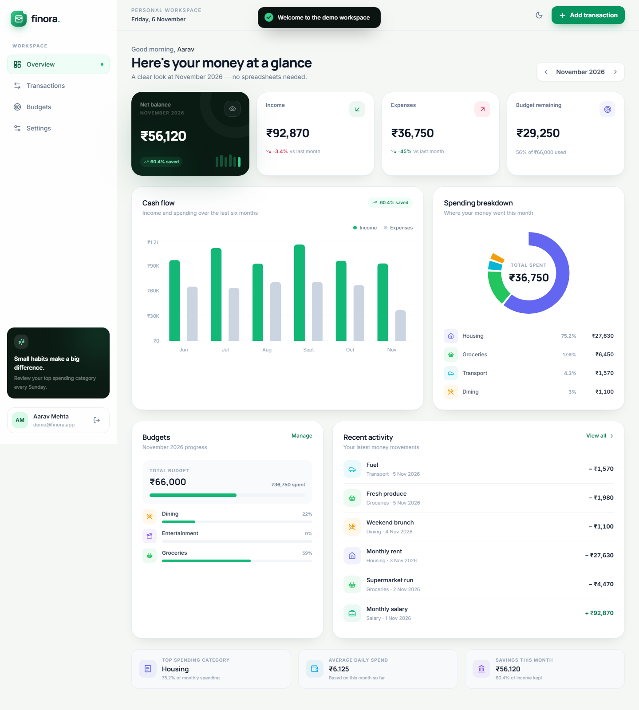
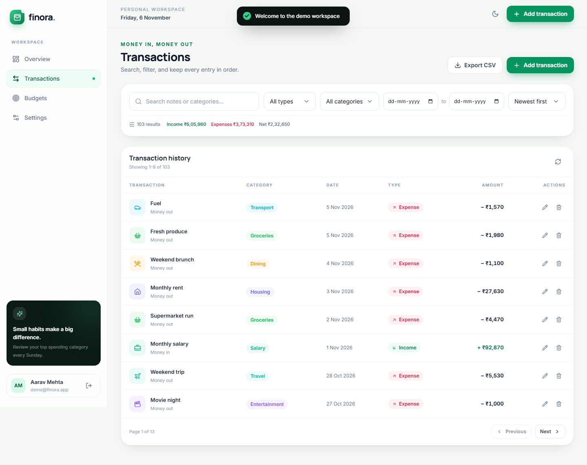
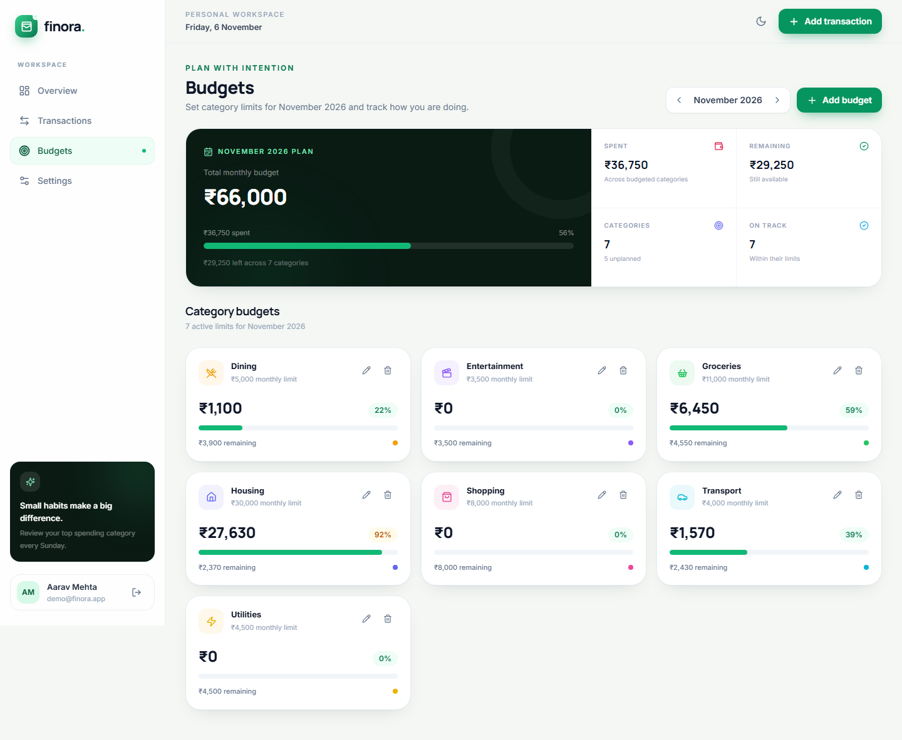
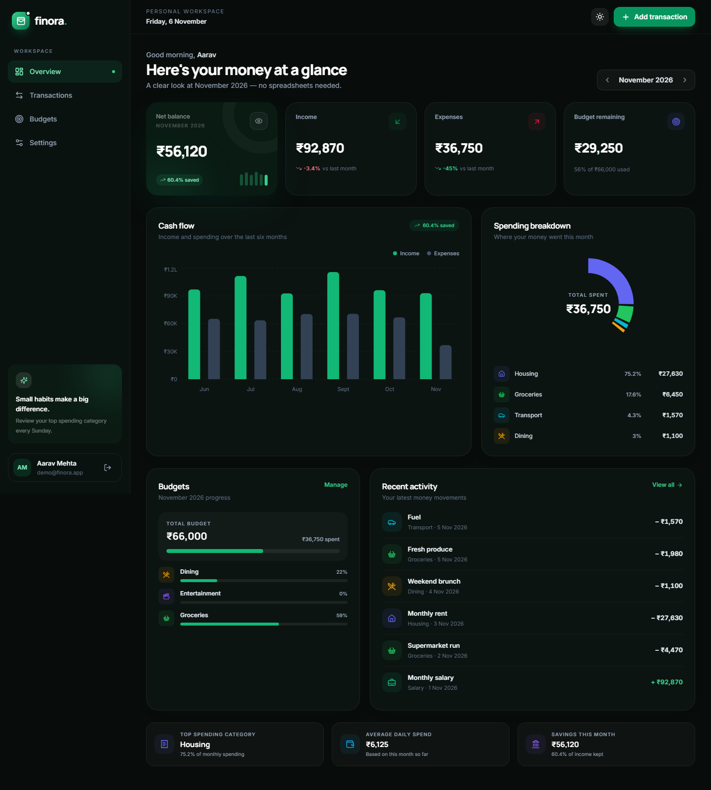
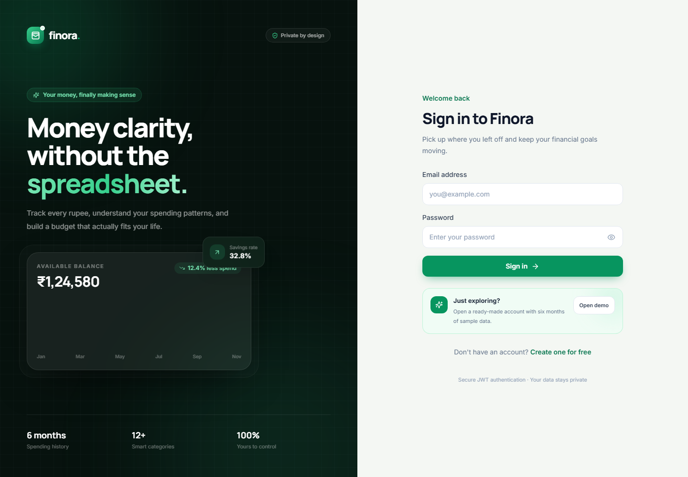
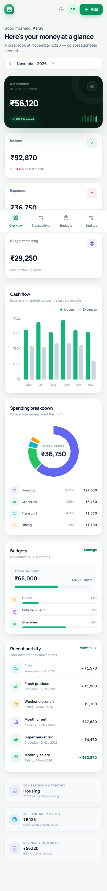

# Finora — Personal Finance Tracker

A full-stack, responsive finance dashboard for tracking income and expenses, visualising spending, and managing monthly budgets.

Built with **React + Tailwind CSS**, **Node.js + Express**, **MongoDB + Mongoose**, **JWT authentication**, and **Recharts**.



## ✨ What it does

- **Secure accounts** — register, log in, and access protected routes with JWT authentication.
- **Transactions** — add, edit, delete, search, filter, sort, and export income/expense entries.
- **Live dashboard** — monthly income, expenses, net balance, savings rate, and month-over-month changes.
- **Visual insights** — category-wise spending donut chart and six-month cash-flow bar chart.
- **Budgets over time** — category budgets by month, spending progress, alerts when nearing or exceeding a limit.
- **Thoughtful UX** — responsive layouts, loading states, empty states, form validation, toast feedback, and light/dark mode.
- **Ready to demo** — with no database configuration, the API starts an in-memory MongoDB and seeds a realistic six-month demo account.

## 📸 Screenshots

| Dashboard | Transactions |
| --- | --- |
|  |  |

| Budgets | Dark mode |
| --- | --- |
|  |  |

| Sign in | Mobile |
| --- | --- |
|  |  |

## 🧰 Tech stack

| Layer | Technology |
| --- | --- |
| Frontend | React 18, Vite, Tailwind CSS, React Router |
| State | React Context API |
| Charts | Recharts |
| Backend | Node.js, Express |
| Database | MongoDB, Mongoose |
| Auth | JWT, bcrypt |
| Validation | Zod |
| Feedback | react-hot-toast, Lucide icons |
| Dev demo DB | mongodb-memory-server |

## 🚀 Quick start

### Prerequisites

- Node.js 18+ (Node 20+ recommended)
- npm 9+
- MongoDB Atlas account or a local MongoDB instance (optional for the demo)

### 1. Install

```bash
npm install
```

### 2. Start the app

```bash
npm run dev
```

Open **http://localhost:5173**.

That's it. With no `MONGO_URI`, the backend automatically uses an in-memory MongoDB and seeds the demo account:

```text
Email:    demo@finora.app
Password: Demo@1234
```

> In-memory data resets whenever the API restarts. Add a real MongoDB URI to persist data.

### 3. Use MongoDB Atlas (persistent data)

```bash
cp server/.env.example server/.env
```

Update `server/.env`:

```env
PORT=5000
MONGO_URI=mongodb+srv://<user>:<password>@<cluster>.mongodb.net/finora?retryWrites=true&w=majority
JWT_SECRET=replace-with-a-long-random-string
CLIENT_URL=http://localhost:5173
SEED_DEMO=true
```

Then either start the app normally or seed the demo account explicitly:

```bash
npm run seed
npm run dev
```

Set `SEED_DEMO=false` if you do not want the demo account created in a real database.

## 🔐 Environment variables

### Server (`server/.env`)

| Variable | Required | Description |
| --- | --- | --- |
| `PORT` | No | API port, defaults to `5000` |
| `NODE_ENV` | Production | Use `production` when deployed |
| `MONGO_URI` | Production | MongoDB Atlas connection string |
| `JWT_SECRET` | Production | Secret used to sign JWTs (32+ characters) |
| `JWT_EXPIRES_IN` | No | Token lifetime, defaults to `7d` |
| `CLIENT_URL` | No | Comma-separated allowed frontend origins |
| `SEED_DEMO` | No | Set `true` to seed the demo account with a real DB |

### Client (`client/.env`)

| Variable | Required | Description |
| --- | --- | --- |
| `VITE_API_URL` | Split deployment | Full API URL, e.g. `https://finora-api.onrender.com/api` |

When deploying the client and API together, leave `VITE_API_URL` empty and use the `/api` proxy/relative path.

## 📜 Scripts

| Command | What it does |
| --- | --- |
| `npm run dev` | Start API + Vite dev server together |
| `npm run build` | Build the React production bundle |
| `npm start` | Start the Express server (serves `client/dist` when present) |
| `npm run seed` | Recreate demo data in the configured MongoDB |
| `npm test` | Run backend unit tests with Node's test runner |

## 🗂️ Project structure

```text
.
├── client/
│   ├── src/
│   │   ├── components/       # UI, charts, transaction + budget components
│   │   ├── context/          # Auth, theme, and shared UI state
│   │   ├── layouts/          # App shell and auth shell
│   │   ├── lib/              # API client, formatting, categories
│   │   └── pages/            # Dashboard, transactions, budgets, settings, auth
│   └── vite.config.js
├── server/
│   ├── src/
│   │   ├── config/           # Environment + database connection
│   │   ├── controllers/      # Auth, transactions, budgets, dashboard
│   │   ├── middleware/       # JWT protection, validation, errors
│   │   ├── models/           # Mongoose schemas
│   │   ├── routes/           # REST endpoints
│   │   ├── utils/            # Date helpers, categories, HTTP helpers
│   │   ├── app.js
│   │   └── server.js
│   └── tests/
└── docs/screenshots/
```

## 🔌 API reference

All transaction, budget, and dashboard endpoints require:

```http
Authorization: Bearer <jwt-token>
```

| Method | Endpoint | Description |
| --- | --- | --- |
| `POST` | `/api/auth/register` | Create account, return JWT |
| `POST` | `/api/auth/login` | Sign in, return JWT |
| `GET` | `/api/auth/me` | Get current profile |
| `PATCH` | `/api/auth/profile` | Update display name |
| `GET` | `/api/transactions` | List with search, filters, sort, pagination |
| `POST` | `/api/transactions` | Create transaction |
| `PATCH` | `/api/transactions/:id` | Update transaction |
| `DELETE` | `/api/transactions/:id` | Delete transaction |
| `GET` | `/api/transactions/export` | Download filtered CSV |
| `GET` | `/api/budgets?month=YYYY-MM` | Budgets + spending progress |
| `PUT` | `/api/budgets` | Create/update monthly category budget |
| `DELETE` | `/api/budgets/:id` | Remove budget |
| `GET` | `/api/dashboard?month=YYYY-MM` | Summary, charts, budgets, recent activity |
| `GET` | `/api/health` | Health check + demo availability |

Successful responses follow:

```json
{
  "success": true,
  "data": {}
}
```

Errors follow:

```json
{
  "success": false,
  "message": "Please check the highlighted fields.",
  "fields": {
    "amount": "Amount must be greater than zero"
  }
}
```

## 🛡️ Security and data handling

- Passwords are hashed with **bcrypt** (cost factor 12) and never returned by the API.
- JWTs are signed server-side and expire after seven days by default.
- Every transaction and budget query is scoped to the authenticated user.
- Request bodies and query parameters are validated with **Zod**.
- API routes are rate-limited; auth routes have stricter limits.
- Helmet, CORS allow-listing, JSON size limits, and centralized error handling are enabled.
- CSV cells are escaped to reduce spreadsheet formula-injection risk.
- The frontend stores the JWT in `localStorage` for a straightforward REST/Bearer setup. For a higher-security production app, consider an HTTP-only cookie + CSRF protection.

## 🚢 Deployment

### Option A — Single service (recommended)

Deploy the Express app and built React client together on **Render** or **Railway**.

- **Build command:** `npm install && npm run build`
- **Start command:** `npm start`
- **Environment:**
  - `NODE_ENV=production`
  - `MONGO_URI=your-atlas-uri`
  - `JWT_SECRET=a-long-random-secret`
  - `CLIENT_URL=https://your-app.onrender.com`

Express serves `client/dist` automatically when it exists, so the SPA and API share one origin.

### Option B — Split deployment

1. Deploy `client/` to **Vercel**.
   - Build command: `npm run build`
   - Output directory: `dist`
   - Environment: `VITE_API_URL=https://your-api.onrender.com/api`
2. Deploy `server/` to **Render** or **Railway**.
   - Start command: `npm start`
   - Add `MONGO_URI`, `JWT_SECRET`, `CLIENT_URL=https://your-vercel-app.vercel.app`.
3. Add the Vercel domain to `CLIENT_URL` so CORS accepts requests.

### MongoDB Atlas checklist

- Create a free cluster and database user.
- Allow network access from your deployment provider.
- Copy the SRV connection string into `MONGO_URI`.
- Run `npm run seed` locally once if you want demo data in the hosted database.

## ✅ Testing

```bash
npm test
```

The backend test suite covers month ranges, six-month trend windows, date normalization, and invalid month handling. Core user flows were also smoke-tested end-to-end in a headless browser: demo login, chart rendering, transaction create/edit/delete, filtering, CSV export, budget create/edit/delete, theme switching, and mobile navigation.

A GitHub Actions workflow in `.github/workflows/ci.yml` installs dependencies, runs the backend tests, and builds the frontend on every push and pull request.

## 🧭 Design decisions

- **Context API over Redux** — auth, theme, and modal state are small enough that Context keeps the app readable without extra dependencies.
- **Month-scoped API** — the dashboard and budgets accept `YYYY-MM`, making historical browsing and future planning straightforward.
- **UTC-noon transaction dates** — avoids off-by-one date rendering across time zones.
- **Category metadata in one place** — colours and icons remain consistent across charts, lists, modals, and budgets.
- **Progressive enhancement** — the app runs with zero database setup, then switches to persistent MongoDB with one environment variable.

## 🗺️ Possible next steps

- Recurring transactions and scheduled reminders
- Monthly email summaries with Nodemailer
- PDF reports and custom date-range exports
- PWA support and install prompts
- Multi-currency support
- Account deletion and password reset flows

## 📄 License

MIT
